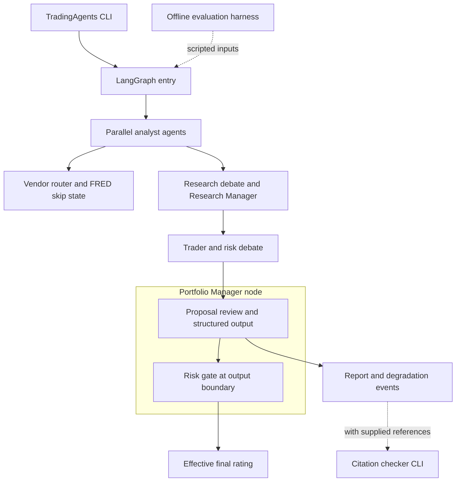

# CS5351 Project Report — TradingAgents

## 0. Team and Relative Contributions

The table records each member’s estimated productive hours. Sprints 1–5 cover requirements and baseline work, architecture and test design, implementation and verification, review and integration, and final delivery, respectively.

| Team member (student ID) | Sprint 1 (h) | Sprint 2 (h) | Sprint 3 (h) | Sprint 4 (h) | Sprint 5 (h) | Total (h) | Relative contribution |
| --- | ---: | ---: | ---: | ---: | ---: | ---: | ---: |
| ZHANG Yating (60868911) | 5.0 | 7.0 | 18.0 | 6.0 | 14.0 | 50.0 | 1.0 |
| WANG Yixuan (60245953) | 12.0 | 6.0 | 10.0 | 8.0 | 14.0 | 50.0 | 1.0 |
| REN Longteng (60662195) | 6.0 | 9.0 | 17.0 | 10.0 | 8.0 | 50.0 | 1.0 |
| LI Jin (60263031) | 10.0 | 10.0 | 10.0 | 10.0 | 10.0 | 50.0 | 1.0 |
| HUANG Siying (60572233) | 5.5 | 7.5 | 18.0 | 12.0 | 7.0 | 50.0 | 1.0 |

The mean contribution was 50.0 hours. Relative contribution equals each member’s total divided by this mean.

The team began by analyzing and running the TradingAgents baseline. ZHANG Yating designed, implemented, and tested the FR-A1 risk gate and wrote the team report. WANG Yixuan developed the FR-B2 citation checker, and REN Longteng developed FR-C2 FRED skip handling. WANG Yixuan and REN Longteng also co-produced the demo video. LI Jin developed FR-D2 retry and degradation handling and integrated the feature branches. HUANG Siying developed the NFR-E1 evaluation harness and CI gates and cross-checked the team’s deliverables.

## 1. Introduction and Project Scope

TradingAgents is a multi-agent application that uses large language models (LLMs) to analyze a financial instrument on a given date. Its analysts collect and summarize market, sentiment, news, and fundamental data. The research and trading agents turn this material into a proposal, and the Portfolio Manager produces a report and investment rating. We extended TradingAgents v0.7.1 from the team baseline at `46bde74`. The integrated code snapshot is `1cc1d9f`; the final report was merged at `b220fff`. [Project snapshot][snapshot]

The baseline made it possible to generate a report, but several parts of the run were hard to verify. A model could propose a trade without a deterministic risk check at the publication boundary. A reader could not reliably trace a conclusion to a structured source reference. An unconfigured data source could be retried within the same run, and a fallback from structured output to free text could be easy to miss. The team also needed a repeatable way to evaluate changes to the application. These observations informed work on decision safety, citation traceability, data-source handling, visible degradation, and offline evaluation.

The delivered system combines a deterministic risk gate, visible structured-output fallback, and run-scoped FRED handling in the application workflow. It also includes a report citation checker, a reproducible offline evaluation harness, and six CI gates. We integrated these changes through PR #14, which merged them into `main`. The submitted repository layout places the application packages in `src/` and separates offline and live tests. [Integration PR #14][pr14]

## 2. Requirements Engineering

### 2.1 From baseline observations to fit criteria

The team reviewed the baseline, recorded 35 candidate requirements, and selected five primary requirements. We kept the candidate pool and the primary registry in separate YAML files. The primary registry records the requirement ID, statement, source, priority, fit criterion, and verification reference. All five primary requirements carry the MoSCoW priority **Must**. Supporting IDs let the team identify a specific deliverable within a broader goal. The schema gate checks the format of the registry. Tests and other verification records provide evidence for the fit criteria. [Primary registry][requirements] · [Candidate pool][options]

### 2.2 Primary requirements and delivery scope

| Requirement | Baseline gap and main fit criteria | Evidence in the integrated version |
| --- | --- | --- |
| **FR-A1 — Decision safety** | Before publication, evaluate the proposed decision against a versioned risk policy and record the verdict, rule IDs, and audit data. The registry includes a 100-fixture safety sweep, a zero-network target, and a p95 latency target. | The Portfolio Manager invokes a deterministic gate at its output boundary. Tests cover violations, incomplete inputs, audit behavior, and the effective rating. |
| **FR-B1 — Evidence traceability** | Associate key decision fields with structured `EvidenceRef` records and exclude unresolved references from the supported count. | The delivered part, **FR-B2**, checks supplied citations against a report and registered evidence files. The output records the result and gives a reason for an unresolved citation. |
| **NFR-C1 — Cost control** | Reduce unnecessary usage. The registry covers token and latency targets, a budget stop, per-agent accounting, and zero retries for unconfigured FRED. | The delivered part, **FR-C2**, skips FRED for the current run when credentials are missing. The tests distinguish tool requests, vendor entry, HTTP attempts, and skip logs. |
| **FR-D2 — Visible degradation** | Allow two retries after an initial parse or validation failure and mark the fallback `DEGRADED` if all structured attempts fail. | The helper bounds the structured attempts. The workflow records a degradation event and marks the affected report output. Offline tests cover retry count and visibility. |
| **NFR-E1 — Reproducible offline evaluation** | Use a fixed evaluation set, record a run manifest, and compare results. The fit criteria include three consistent repeat runs, token variation within 5%, zero network calls, and an offline run within ten minutes. | The harness drives the real graph with scripted inputs for three cases. It records a manifest and exports a comparison. The CI workflow runs six gates, including a scripted evaluation gate. |

We used the fit criteria to choose what to measure. For example, FR-C2 measures repeat requests to an unconfigured vendor, while NFR-E1 measures repeatability under a fixed setup. In the risk gate, the fixtures exercise the policy rules and the publication outcome. Each test addresses a behavior that reviewers can match to the corresponding requirement. The verification results in Section 4 show the scope of that evidence.

## 3. Architecture and Design Decisions

### 3.1 Integrated architecture

The CLI starts the LangGraph workflow. The analysts can run in parallel and obtain data through the vendor router. The research debate and Research Manager prepare an investment plan. The Trader prepares a trade proposal, the risk analysts debate it, and the Portfolio Manager forms a decision. The offline evaluation harness drives this same graph with fixed inputs. The citation checker runs as a separate CLI over a report and its supplied sources. Figure 1 shows these paths and the risk gate inside the Portfolio Manager node. [Architecture blueprint][blueprint]

*Figure 1. Integrated application and verification paths.*

The graph uses run state for intermediate reports, proposals, decisions, verdicts, and degradation events. The vendor skip state is scoped to one independent analysis run. Related paths can share it within that run, while a later run starts with fresh state. The evaluation harness keeps artifacts for repeated runs separate so that saved memory and output files do not change the inputs or overwrite the results of a comparison.

### 3.2 Risk gate and structured-output boundary

The FR-A1 architecture decision considered embedding all risk logic inside the Portfolio Manager, adding a separate graph node, and wrapping the graph after execution. We selected a pure risk engine with an adapter at the existing Portfolio Manager output boundary. The engine can be tested with fixed inputs, and the adapter applies the result before a rating is exposed to downstream consumers. This kept the decision logic independent of the LLM and avoided the need for a new graph node. The integrated CLI also accepts `--risk-portfolio` so that a caller can provide the portfolio snapshot used by the gate. [Risk-gate ADR][a1adr]

The gate combines the Trader proposal, the Portfolio Manager decision, the supplied portfolio snapshot, and a versioned policy. For a cash-funded long BUY, the default policy checks for a stop-loss and uses a 10% single-name cap, a 30% sector cap, and a minimum reward-to-risk ratio of 1.5. Each evaluation returns a verdict and rule outcomes. The adapter writes the audit before publishing an actionable rating. If the audit cannot be written or the input cannot support approval, the public signal is `REVIEW`. An approved `HOLD` can retain its rating with `NO_TRADE` status. [Risk-gate policy][a1policy]

| Field or output | Meaning in the integrated workflow |
| --- | --- |
| `model_rating` | The model's rating, retained when available. |
| `risk_verdict` | The gate's `APPROVED`, `REJECTED`, or `NEEDS_REVIEW` verdict. |
| `final_rating` | The effective public rating produced by the gate adapter. |
| Report text and degradation events | The written analysis and any record of fallback, collected separately from the effective rating. |

The structured-output helper retries a parse or validation miss twice after the first attempt. A provider that cannot bind the schema goes directly to the free-text fallback. The Portfolio Manager records a `DEGRADED` event and continues to produce report text. If its fallback leaves the gate without a structured decision, the same run can publish a marked report and a `REVIEW` rating. The report tells readers what happened, while the gate controls publication of the actionable signal. [Structured-output helper][structured]

### 3.3 Data-source handling, citation checking, and evaluation

The FRED change uses run-scoped state at the vendor routing boundary. The first request can determine that FRED is unconfigured. Related requests in the same run can reuse that result and avoid repeating the check or logging a second skip. The state coordinates concurrent requests and allows the router to continue to a configured fallback where available. A later run starts with fresh state so restored credentials can be used. A request that times out while waiting follows the vendor fallback path and keeps the distinction between a timeout and missing credentials. [FRED implementation and verification][c2verification]

FR-B2 checks whether the specified passage appears in the report and whether the source ID, locator, and expected excerpt resolve. `SUPPORTED` means those checks found the referenced material. `UNTRACEABLE` includes a reason such as a missing citation, unknown source, or invalid locator. The checker verifies reference resolution and runs without a model call. [Citation checker guide][b2guide]

For evaluation, we compared a standalone runner, a real LLM with mocked data vendors, and full recording and replay. The standalone runner would leave graph behavior outside the test. A real LLM would introduce network and response variation. Full replay would first require captured responses. We selected scripted data and model sources that drive the shipped graph. This lets us test the graph under controlled conditions and run the same cases in CI. The runner records case and run IDs, model and configuration data, token usage, tool events, and output paths so readers can tell which run produced a result. [Evaluation ADR][e1adr]

### 3.4 State and persistence boundaries

The graph state holds information used within a run, including intermediate reports, the structured Trader proposal, the Portfolio Manager decision, and the risk verdict. Structured values can then pass between components without parsing the rendered report. The production workflow also has a memory log for completed decisions and lessons. The Memory Log step retrieves lessons relevant to the instrument and date. For historical runs, it uses the trade date as the cutoff for what could have been known. [Memory and state design][memory]

| State | Lifetime and purpose |
| --- | --- |
| Graph state | Carries the intermediate outputs and decisions for one analysis. When checkpointing is enabled, the checkpoint supports resuming an interrupted run. |
| FRED skip state | Tracks the unconfigured vendor within one analysis. A fresh run can use a newly configured credential. |
| Production memory | Keeps completed decisions and lessons that can inform a later run. |
| Evaluation artifacts | Use an isolated run ID, results directory, memory log, and state log. These artifacts allow repeated runs to start from equivalent conditions. |

The distinction mattered in testing. A caller can reuse the same configuration to start two runs, so run-local routing state must be attached to a copy of the configuration. In the evaluation harness, the results and memory paths also need to be isolated. Otherwise, one run could overwrite evidence from an earlier run or change the input seen by the next repeat. The FRED tests cover reused configuration, and the evaluation suite checks the separation of its logs.

## 4. Verification and Governance

### 4.1 Working with the coding agent

The repository uses `AGENTS.md` and `Prompt.md` to guide OpenCode. A plan identifies the requirement, affected interfaces and files, scope, and verification strategy. The prompt instructs the agent to stop for human approval before implementation and again after self-verification. The repository also records file permissions and distinguishes reference files and human-owned governance files from approved change targets. The project rules require a negative test for new feature behavior and human approval for safety-critical changes. [Agent governance][agents]

The NFR-E1 approval record names the tests reviewed before implementation. The FR-A1 milestones record separate reviews for test design, the core engine, and integration. For FR-B2, the baseline and test design were approved before implementation, followed by two review rounds. These records show how the team used checkpoints to review an approach and its tests before accepting the resulting code. The AI-use log records the relevant work and links session evidence where available. [NFR-E1 approval record][e1approval] · [AI-use log][ailog]

### 4.2 Offline, live, and regression testing

The D8 migration placed application packages under `src/`, deterministic tests under `test/offline/`, and the API-dependent test under `test/live/`. The default `pytest` configuration excludes tests marked `integration`. CI installs the project before running the default suite. The repository's opt-in live test calls the DeepSeek endpoint directly and checks whether that client returns a typed structured response. The FR-B2 record separately documents a report generated using the CityU LLM gateway, which the citation checker then verified offline. [Live client test][livetest]

| Verification area | Recorded result |
| --- | --- |
| Local integrated regression | The run recorded in PR #14 reports **1,789 passed**, 6 skipped, 1 deselected, and 1 xpassed on the integration tip at `5801e5f`. [PR #14 verification][pr14] |
| GitHub Actions on PR #14 | **10 successful jobs**, including five single gate jobs, four regression matrix jobs, and the clean-install smoke test. [PR workflow run][ci14] |
| GitHub Actions on `main` | The push at `1cc1d9f` succeeded. Eight jobs passed and two PR-only jobs were skipped by design. [Main workflow run][cimain] |
| GitHub Actions on final `main` | The push at `b220fff` after the report merge also succeeded; the same two PR-only jobs were skipped by design. [Final main run][cifinal] |
| Citation checker | The six supplied AAPL examples produced one `SUPPORTED` and five `UNTRACEABLE` results. [FR-B2 sample evidence][b2verification] |
| Offline evaluation | The harness recorded results for three fixed cases under both scripted profiles. Section 4.4 gives the per-case results. |

The automated checks exercise representative conditions for each workstream. For FR-A1, a test checks that none of 100 distinct invalid fixtures receives `APPROVED`. The core risk engine runs under a socket guard in a separate test, and a latency test checks the two-second p95 threshold over 1,000 core-engine evaluations. For FR-C2, a graph test sends several macro requests in one run and checks that FRED is entered once, no HTTP requests are sent, and one skip is recorded. FR-D2 tests check both the attempt count and whether warnings appear in the report after degradation. The NFR-E1 repeat-run test checks that its three runs have the same effective rating. Each assertion supports a specific fit criterion. [Invalid fixture tests][a1fixtures] · [Risk-engine latency and network tests][a1runtime] · [Degradation tests][d2tests]

### 4.3 CI gates and what they establish

| Gate | Implemented check and evidence boundary |
| --- | --- |
| **1. Test approval** | Checks that the approval record has the required fields. The scope and timing of approval come from the human records. |
| **2. Static analysis** | Runs Ruff, dependency consistency checks, byte compilation, mypy on the safety-critical modules, a permission-model check, a targeted secret scan, layering/prompt-integrity contract tests, and a public-package import smoke. Full-repo type-checking and a full API-compatibility suite remain outside this gate. |
| **3. Requirements schema** | Validates `requirements.yaml` against `req-schema.json`. A deliberately invalid registry in PR #7 triggered the schema gate and the PR was closed without merging. |
| **4. Semantic evaluation** | Runs the scripted evaluation tests and checks the expected behavior of the fixed cases. |
| **5. Regression** | Runs the project suite across the supported Python matrix used by CI. |
| **6. AI-use log** | Checks that relevant code or prompt changes have a corresponding log entry. The log and session records provide the basis for checking the contents of an entry. |

The documented `main` branch protection lists nine required checks and one approving review. Gate 1 and Gate 6 run on pull requests. The clean-install smoke test is an additional workflow job. Local negative tests exercise failure paths in the gate scripts. PR #7 provides a GitHub example of the schema gate rejecting an invalid registry. Together these records show the difference between passing the normal workflow and exercising a gate with known invalid input. [Branch protection evidence][protection] · [Negative PR and test evidence][e1testlog]

### 4.4 Reading the offline comparison

The evaluation fixture identifies each case by its ticker and trade date. In the recorded comparison, both scripted profiles run all three cases through the application graph. The comparison writes one row per case, with the effective rating, token total, elapsed time, and tool-call count. Keeping the case IDs in the output makes it possible to match each comparison row to the run artifacts. [Comparison output][compare]

| Fixed case | Effective rating in both profiles | Recorded token totals | Completed tool calls in both profiles |
| --- | --- | --- | --- |
| NVDA, 2026-01-09 | `REVIEW` | 2,250 → 2,100 | 12 |
| AAPL, 2026-01-16 | `REVIEW` | 2,250 → 2,100 | 12 |
| MSFT, 2026-01-23 | `REVIEW` | 2,250 → 2,100 | 12 |

The comparison and the repeatability test answer different questions. The comparison checks that the harness records differences between two configured profiles. The repeatability test runs one fixed profile three times on the same case. It checks rating consistency and verifies that the spread of the token totals stays within 5%. Another test intercepts the network entry points used by the harness and checks that no connection was attempted. The timing test checks that the three-run scripted suite finishes within ten minutes. These checks give reviewers concrete evidence for the offline fit criteria. [Repeatability, network, and timing tests][e1constraints]

The manifest also helps reviewers interpret a result after the run. The runner captures requested tool calls separately from completed tool calls. A test changes prompt content and checks that the manifest's SHA-256 prompt hash changes as well. These checks tie the reported data to observed events and the prompt files used to produce it. [Manifest tests][e1offline]

### 4.5 Feature review and integration review

The feature reviews and the integration review covered different scopes. Reviewers requested changes on the NFR-E1, FR-B2, FR-C2, and FR-A1 feature PRs. The team used feature tests to reproduce issues close to the component that owned them. It used the integration suite to check whether the fixes still worked when all workstreams shared the same graph and repository layout. [PR #6][review6] · [PR #11][review11] · [PR #9][review9] · [PR #12][review12]

| Review stage | Evidence used in the delivered project |
| --- | --- |
| Evaluation harness | The review follow-up added checks for repeat-run token variation, network isolation, runtime, and the prompt hash. The verification record reports 45 passing targeted tests for the harness and CI gates in that round. |
| Citation checker | The author approved an integrity follow-up, and regression tests were added before the verifier. The later feature run recorded 18 passing tests and a separate check of the registered file digests. [FR-B2 verification][b2followup] |
| Risk gate | The integration fixes covered an approved `HOLD`, the handling of position sizing, a CLI option for supplying the portfolio snapshot, and the fail-closed path for incomplete or malformed inputs. These changes were carried in the integrated version. [PR #13 change and test record][pr13] |
| Integration | PR #13 received approval for the changes to the integration branch. The approval on PR #14 specifically records a check of FR-C2 integration and a rerun of its related tests. Full-project regression is evidenced by the CI and local runs in Section 4.2. [PR #13 approval][review13] · [PR #14 approval][review14] |

This process gave the team two ways to verify a change. A focused feature test could show that a particular failure had been corrected. The integrated regression could then check that the same code worked with the other changes and with the install and test commands used for delivery. The review record and the test run each show which part of that verification they covered.

## 5. Process Quality and Improvement

### 5.1 Requirement volatility

The five primary requirement IDs stayed the same between the retained team baseline and the integrated registry. Their behavior, fit criteria, and verification mappings still changed as the team learned more. FR-D2 provides a clear example. The baseline called for one retry after a structured-output failure. The feature change raised this to two retries, recorded the intermediate `RETRY` state, and specified a visible `DEGRADED` event after the final failure. The change updated both requirements registries and added tests for the new limit and fallback behavior. [FR-D2 feature commit][d2commit]

Other registry changes made the recorded scope more accurate. FR-B1 and NFR-C1 were marked partial and their verification references were aligned with the citation and vendor-skip tests that actually exist. NFR-E1 retained repeatability as its goal but limited the 5% assertion to token variation. Wall-clock latency is still recorded and the offline suite has a time limit. This avoided a tight latency assertion that the team found sensitive to timing variation on scripted runs. These examples show how wording and evidence changed even when the primary requirement IDs stayed stable. [Registry and test alignment][localrepair] · [Evaluation trace matrix][trace]

### 5.2 Defects observed across development and integration

The available records show issues at different stages. During feature development, the evaluation manifest counted both requested and completed tool calls as executions. One golden case reported 24 tool calls when 12 actually ran. The corrected implementation separates the request and completion totals, and a test checks that the completed count matches the tool callback count. In the FRED feature, the team corrected the test counters before implementing the change. Separate counts for tool requests, data-source entry, HTTP attempts, and logs made it possible to tell where a repeat request stopped. [Bug diary][bugdiary]

During integration, issues involved assumptions shared across features. The risk gate changed the published result for the affected test runs, which exposed fixed rating assertions in the evaluation and FRED tests. The source migration then changed import and discovery paths, so the team checked package installation, test discovery, CI commands, and evidence scripts from a clean checkout. The records show how the focus of verification moved from component behavior to interactions between features and finally to the packaged repository.

The defect records show a change in what the team needed to verify. At the component level, the main question in the recorded cases was whether the tests and logs measured the intended behavior. A single tool-call total hid the difference between a request and a completed call. Likewise, observing that FRED sent no HTTP requests could leave open whether the data-source path had been reached. The separate counters made those cases easier to diagnose and gave reviewers a way to check where the behavior occurred.

At integration, the team also had to check whether each test still depended on the right output. A fixed rating assertion linked the evaluation and FRED tests to a decision made elsewhere in the graph. Once the risk gate could change the published rating, a failed assertion could point to an outdated expectation even when the feature met its fit criterion. The revised checks kept the repeatability and vendor-skip assertions. A clean checkout added a further check that the integrated behavior could be exercised through the commands used for delivery.

Taken together, these cases suggest a practical review question for future changes. For each integration test, we should identify which component owns the expected result and what evidence would show that its behavior changed. This comparison describes the kinds of issues found at each stage based on the available records.

### 5.3 Ambiguity resolution during integration

**What should the evaluation and FRED tests check?** Some tests expected `Overweight` because that was the scripted model output. When FR-A1 was integrated, those runs could publish `REVIEW` if `risk_portfolio` was absent. We compared the assertions with the fit criteria. The NFR-E1 test needed to check that repeated runs agreed, and the FR-C2 test needed to check that an unconfigured FRED source was skipped. The revised tests accept the scripted rating or `REVIEW` as appropriate, while retaining the repeatability and vendor-behavior assertions. The reason for the new rating was recorded in the test comments. [Evaluation integration change][e1rating] · [FRED integration change][c2rating]

**What can a degraded Portfolio Manager result publish?** FR-D2 allowed the workflow to continue with a free-text report after a structured-output failure. Before integration, that path also parsed a rating from the free text. FR-A1 gave the gate authority over publication. The team clarified that the workflow could finish and report degradation while the gate still controlled `final_rating`. If the fallback did not produce a structured decision for the gate, the public signal became `REVIEW`. The report content and degradation event remained available for review. [Integration merge][mergeconflict]

### 5.4 Changes to the engineering process

The project made the evidence behind a passing test more specific. The FRED work separated requests, data-source entries, HTTP calls, and skip logs, which helped reviewers check each part of the requirement. Evaluation tests separated repeatability from the exact trading rating. At the repository level, the workflow added a schema check and a repeatable offline evaluation alongside the regression suite. PR #7 tested one of these controls with a deliberately missing fit criterion. Together, these changes made it easier to tell whether a failure came from the requirement, the application, or the test.

The integration review showed where two kinds of checks were needed. Feature tests should follow the fit criterion for the feature under test. For FR-C2, the checks cover entry into the FRED data source, outbound HTTP attempts, and the skip warning. For NFR-E1, the repeatability check compares effective ratings across equivalent scripted runs. These checks can still provide useful evidence when another component changes the expected rating for a fixture.

A separate integration test should verify the contract at the Portfolio Manager output boundary. The rating assertions described in Section 5.3 allowed the feature tests to keep checking their own behavior. A dedicated test could verify the published rating directly. In a future revision, we would use two fixtures with the same scripted proposal and otherwise equivalent inputs. One would omit the portfolio snapshot and require `REVIEW`. The other would supply a valid snapshot under which the proposal passes the applicable risk rules. That case would require the specific published rating expected for its inputs. Keeping the expectations separate would help us identify which behavior changed if a test failed.

For future cross-feature changes, we would also record which component owns each shared output and link its expected behavior to the fit criterion, design decision, and test. The reviewer could then decide whether a change calls for an updated fixture, a new assertion, or a revision to the requirement itself.

## 6. Artifact Co-evolution

The integration changes can be traced from the expected behavior to the component that enforces it and the tests that check it. The following examples show how the team carried a change across the affected artifacts.

### 6.1 Risk gate and structured-output fallback

| Artifact | Integration outcome |
| --- | --- |
| Requirements | FR-A1 defines deterministic risk validation before decision publication. FR-D2 defines the retry limit and requires a visible fallback. Both requirements informed the integration at the Portfolio Manager output boundary. |
| Design | The risk-gate design identifies the Portfolio Manager output as the enforcement point and assigns distinct meanings to the model rating, gate verdict, and effective public rating. |
| Implementation | The Portfolio Manager uses one call to the structured-output helper. It passes the resulting decision to the gate and records a `DEGRADED` event when the helper falls back. The graph state appends events from multiple nodes. [Portfolio Manager][pm] |
| Tests | The merged tree includes the degradation suite and risk-gate suites. The downstream evaluation and FRED tests were also changed to accept the integrated `REVIEW` outcome while verifying their original fit criteria. |

The integrated scripted comparison was refreshed to show the resulting `REVIEW` output on the three golden cases. Those fixtures exercise the graph with the portfolio input setup used by the harness. Risk-gate approval and rejection are exercised by the dedicated FR-A1 tests. Keeping both forms of evidence makes it possible to read the benchmark and the risk test results in the right context.

The FR-A1 ADR also records a design revision within the feature itself. An earlier integration plan described a separate graph node. When the team inspected how the CLI, reports, state logs, and API consumed `final_rating`, it chose one adapter call at the Portfolio Manager boundary. The structured proposal and decision were already available there. The revised design kept the risk engine independent and made the effective publication field explicit. The code reflects that later decision in the ADR, which explains why the diagram in Section 3 places the gate inside the node. [FR-A1 integration decision][a1revision]

### 6.2 Moving from mapped directories to the required physical layout

The repository originally documented a mapping from its existing directories to the required course layout. PR #13 moved the packages and tests to `src/`, `test/offline/`, and `test/live/`. The same change updated package discovery in `pyproject.toml`, test imports, CI scripts, and demo commands and evidence. In a clean checkout, the team verified that package imports came from `src/` and that the workflow passed. The directory structure, packaging configuration, and test execution therefore describe the same repository layout. [D8 migration PR #13][pr13]

### 6.3 Preserving the evidence behind citation checks

The FR-B2 follow-up aligned the checker, its examples, and its verification record. The checker verifies whether each supplied reference resolves. A separate integrity command checks that the saved evidence still matches the registered SHA-256 digests. The review added tests for a changed file, a missing file, and invalid integrity input, and kept the six-example citation check as a regression case. The later feature record shows 18 passing offline tests and 25 of 25 registered evidence files matching their digests. The original citation outcomes stayed at one supported and five untraceable. [FR-B2 review and verification][b2followup]

The project also documented how to interpret the two commands. A completed citation run can exit successfully while reporting `UNTRACEABLE` findings in the result JSON. The integrity command reports whether the evidence files themselves match the saved digest registry. This distinction allows a caller to tell whether the checker ran, what it found, and whether the evidence files are still the ones recorded for comparison.

## 7. Human Oversight

The cases below come from annotated D5 transcripts. They record the issue the team member raised, the change they asked for, and the result they reviewed.

### 7.1 FR-B2 — Protecting the evidence used to check citations

After 11 tests passed, WANG Yixuan independently checked what happened when `--out` pointed to an evidence file registered in the source table. Using a temporary copy, he reproduced an overwrite that the agent's original input-path checks had missed. He asked for a regression test that required exit code `2` and checked that the evidence bytes were unchanged. The fix extended output protection to the registered evidence paths. The recorded follow-up shows 12 offline tests passing and the original six-sample citation results staying consistent. [D5 intervention][b2d5] · [D5 acceptance][b2d5result]

### 7.2 FR-C2 — Catching timeout and run-state defects in review

REN Longteng relayed two issues reproduced during review. A request that timed out while waiting for a shared result could still enter the vendor data source. Also, two independent runs could share skip state if the caller reused the same configuration. He asked the agent to write failing regression tests before correcting the router or configuration handling. The recorded results show that a timed-out request now takes the fallback path without entering the data source. In the second case, a later run with restored credentials can call FRED and the caller's original configuration remains intact. [D5 review instructions][c2d5] · [D5 regression results][c2d5result]

### 7.3 FR-A1 — Reproducing safety defects before authorizing a fix

ZHANG Yating asked the agent to probe invalid final ratings, inconsistent sector classification, and non-positive prices. These edge cases needed explicit tests because an unsafe result could otherwise reach the publication boundary. The targeted tests recorded 10 failures and three passes before the changes were approved. She then authorized a patch limited to the demonstrated defects. All 13 targeted tests passed after the patch. The review tied the scope of the changes directly to tests that showed the original behavior. [D5 safety review][a1d5] · [D5 approval and result][a1d5result]

### 7.4 NFR-E1 — Correcting the explanation for a zero tool count

HUANG Siying used a direct check to show that a `ToolNode` in a subgraph can trigger `on_tool_start`. The zero count in the baseline run came from how callbacks were passed to the graph. The baseline helper set callbacks on the model client, but the `propagate` path did not forward them in the graph configuration. She asked the agent to correct its explanation and revisit where the manifest should get tool counts before writing code. The evaluation runner uses `stream_run` with the graph configuration so that it can collect runtime events. [D5 correction and agent response][e1d5]

### 7.5 FR-D2 — Clarifying retry behavior before approving implementation

OpenCode flagged two possible readings of “two retries.” LI Jin confirmed that FR-D2 allowed one initial attempt and up to two retries. He also clarified that `RETRY` was an intermediate state and that the affected report section should show a warning after fallback. He asked OpenCode to present a concrete plan and wait for explicit approval before editing any code. He approved implementation after the plan specified the attempt limit, the report warnings, and the tests for both retry counting and visible degradation. [D5 clarification][d2d5clarification] · [D5 plan and approval][d2d5approval]

## 8. Individual Reflections

### ZHANG Yating (60868911)

My main responsibility in this project was FR-A1, the deterministic risk gate for TradingAgents. I also wrote the team report. The hardest part of FR-A1 was deciding what the system could publish when the model’s recommendation looked reasonable but the inputs were incomplete. To make that decision testable, I defined separate outcomes for a confirmed rule violation, missing or invalid input, and a proposal that passed the applicable checks. This gave me concrete criteria to use when reviewing the code produced by OpenCode. 

The test-first process was especially valuable when I reviewed the initial risk engine. I asked for failing tests for three cases: an invalid final rating, inconsistent sector labels, and non-positive prices. For example, a price could satisfy the expected ordering and still be zero or negative. Writing a test for that case made the gap clear and gave me a specific result to check after the fix. I learned to ask whether a test would fail if the safety rule were broken. A passing suite is useful only if its assertions cover the behavior that matters. 

Integration raised a different question. I initially considered adding a separate graph node for the risk gate. After tracing where the final rating was read, I chose to run the gate at the Portfolio Manager’s output boundary. This let the API, CLI, and reports use the same effective rating. I also required the audit record to be saved before an actionable recommendation could be published. An integration test helped me verify that the system returned `REVIEW` when the audit destination was unavailable. 

Writing the team report made me apply the same care to our evidence. I had to distinguish what each requirement called for, what the merged system implemented, and what the tests demonstrated. In a future project, I would agree on shared output fields and failure behavior earlier, then add cross-feature tests before merging. I would keep the staged approvals I used with OpenCode. Having the agent explain its plan and show a failing test before a fix gave me a clear point to intervene and made the final result easier to verify.

### WANG Yixuan (60245953)

My contribution to this project was FR-B2, a citation checker for reports generated by TradingAgents. I used OpenCode to reproduce the upstream application and implement the checker. I defined the acceptance criteria, reviewed the proposed tests, and approved implementation in stages. At first, I found it difficult to turn the broad idea of “trustworthy conclusions” into a feature that I could assess. Specifying observable outcomes helped me make the task manageable. 

I separated baseline reproduction from feature development. Before approving implementation, I asked OpenCode to pin the upstream version, record the environment, and produce a real AAPL report with corresponding evidence. This made later results easier to interpret. I also learned to describe evidence provenance precisely: the market snapshot was fetched separately before the analysis. Calling it a captured agent tool response would have overstated what the record showed. 

For FR-B2, I chose an independent command-line interface with supplied claims and citations. This reduced dependence on my teammates’ modules and allowed repeated offline testing. I required one valid citation and five negative cases, with invalid references excluded from the supported count. I became more careful about the word “supported”: in this checker, it means that a citation resolves to the specified source text. It does not establish that the evidence logically supports the conclusion or that a calculation is correct. 

The review process exposed weaknesses in my initial test design. Eight passing tests did not cover missing report excerpts, unreadable evidence, or output paths that could overwrite inputs. Through AI-assisted review, I requested regression tests before fixes. A later check showed that protecting the three direct input files still left registered evidence files vulnerable to overwriting. Extending that protection taught me to consider all resources an operation depends on. I should have included these cases in the original acceptance design. 

I also underestimated the work required to share the feature. Moving it into the team repository required updated paths, documentation, authentication, CI checks, and peer review. The later integrity checks helped detect changes to saved evidence, although they could not establish its original authenticity. 

In future work, I would define failure cases and integration conventions earlier, then review each proposed change against those requirements. I would retain the staged approvals and complete interaction record because they make my decisions open to examination. OpenCode accelerated implementation, but I still needed to understand the feature’s limits and justify accepting its results.

### REN Longteng (60662195)

My main task in this project was FR-C2. This feature stops the system from repeatedly trying to use FRED when its API key is missing. I used OpenCode to develop it. I reviewed the plan and tests before approving the implementation. At first, I thought this was a simple task: check whether the key exists and skip FRED if it does not. However, I soon found that the same analysis could request FRED data many times. 

To make the goal clear, I made several checks. When the key is missing, the system should enter the FRED data function only once during each run. It should make no HTTP requests and record only one skip warning. The analysis should continue. I learned that tool requests, data-source calls, HTTP requests, and logs are different things. Counting them separately helped me understand what the system was actually doing. 

The hardest part was handling calls that happened at the same time. Several workers could try to access FRED before the first call finished. We needed them to share the result of that first check. We also needed a fresh state for each new analysis. Otherwise, a later run might keep skipping FRED even after the user added a key. This helped me understand why the lifetime of shared state matters. 

Review also found cases that I had not considered. One issue allowed a waiting call to enter the data source after a timeout. Another caused separate runs to share state when they reused the same configuration. I asked for tests covering these cases before accepting the fixes. I realised that passing the normal tests was not enough. Delays, repeated runs, and reused objects could also reveal problems. 

We tested normal, debug, and streaming execution, as well as concurrent calls and recovery after adding a key. During team integration, the risk gate changed some final ratings to `REVIEW`. I learned that this did not necessarily mean FR-C2 was broken. We still needed to check its own results: one data-source entry, zero HTTP requests, and one skip log. 

In future projects, I would think about failure cases and team integration earlier. I would also keep the step-by-step approval process and test records. OpenCode made the work faster, but I still had to check its suggestions and understand the results. This project taught me to judge completion through clear evidence, rather than simply seeing that the code runs.

### LI Jin (60263031)

I was responsible for handling invalid model output in TradingAgents and later for integrating our team’s five features. One detail I underestimated was the word “retry.” I could read “two retries” in two ways and end up writing two different tests. We agreed that the model gets an initial attempt and, if needed, two more calls. We wrote that limit into the requirement and used a test that deliberately supplied invalid output to check what happened on the third failure. The distinction also mattered to someone reading the report. During a retry, the program still had a chance to recover. After the last failure, it could continue with free text, but the report had to display DEGRADED so the reader knew that the structured output had failed validation. Following one example from the requirement through the code, test, and report helped me catch places where a change in wording could change the behavior. The harder decision came during integration. Two tests for the macroeconomic data feature expected an Overweight rating. After I merged the portfolio risk check, those examples returned REVIEW because neither supplied a portfolio snapshot. OpenCode showed me which assertions failed. I still had to decide what the system should tell a user when it lacked the information needed to assess risk. I kept the REVIEW decision and checked that the macro tests still covered their original purpose, including making zero HTTP requests when the data key was missing. All six project checks passed on the version I handed over for cross-validation. Looking back, I would improve one part of my work. Our revised tests accepted either Overweight or REVIEW, so a future bug could produce the wrong one and still pass. I would add two cases with explicit expectations: a missing snapshot must produce REVIEW, and a complete snapshot with known inputs must produce its expected rating. That would give the next reviewer something I wish I had at the start of integration: a test that explains which feature takes precedence and why.

### HUANG Siying (60572233)

At the beginning of the project, I felt genuinely lost. Although I had read the project specification, I could not picture what "process quality" or "co-evolving artifacts" meant in practice, and with a multi-agent trading system I did not even know where to start. At first I talked to the coding agent without a clear plan, and it produced a lot of plausible-sounding content that did not fit together. The turning point was learning to ask one concrete question at a time — what a module actually does, which part of the code a requirement maps to, or why a gate fails — and then checking the answers against the actual repository instead of accepting them at face value. Through this step-by-step dialogue, my understanding of the project grew far faster than it would have from reading the code alone. 

This project also changed how I understand the whole software development process. Before it, I simply defined "done" as "the code produces the right answer", which is exactly how I used to work on algorithm exercises and small projects. I had never set up a continuous integration (CI) pipeline, never opened a pull request (PR), never waited for code review before merging, and never had a security check or blocking gate stop defective code. Working with requirement registries, architecture decision records, six blocking gates, branch protection, and PR-based code review made me realize how many key steps I had skipped in engineering practice. In retrospect, some of my earlier work was not just non-standard; it could not be reproduced or verified by anyone else, and if someone had handed me such results, I would not have trusted them. 

Finally, I learned to write more precise prompts and to manage context consciously. I began to clearly define the agent's role, inputs, constraints, and expected output, and I learned to keep conversations focused, break long tasks into smaller ones, and summarize before the context became messy. These skills apply directly to my other projects: I now treat the agent as a supervised collaborator rather than a magic answer generator, and I verify its output before trusting it.

## 9. Verification Evidence Index

The final repository keeps one evidence location per requirement. This index is the shortest path from a claim in the report to the record that supports it.

| Requirement | Primary evidence | What the record establishes | Remaining boundary |
| --- | --- | --- | --- |
| FR-A1 / INV-A1 | `docs/evidence/fr-a1/` and the risk-gate suites | 100 invalid fixtures never receive `APPROVED`; approved `HOLD` keeps its rating; malformed inputs fail closed. | The delivered gate covers cash-funded long BUY; SELL/short and the human approval queue are deferred. |
| FR-B1 / FR-B2 | `docs/evidence/fr-b2/verification.md` | One supplied AAPL citation resolves; five negative cases are `UNTRACEABLE`; registered evidence digests are checked. | The checker verifies resolution, not logical or arithmetic truth; FR-B1 itself is partial. |
| NFR-C1 / FR-C2 | `docs/evidence/fr-c2/implementation-verification.md` | A missing FRED key yields one source entry, zero HTTP attempts and one skip per run; a later run with a key fetches normally. | Token budget, hard cap and per-agent ledger are not implemented. |
| FR-D2 / INV-D1 | `test/offline/test_structured_degradation.py` | A failed structured call makes three attempts at most; every exhausted path records `DEGRADED` and a visible report warning. | The eval metric remains scripted, not a real-input quality threshold. |
| NFR-E1 | `docs/evidence/e1/verification/test-results.txt` and `docs/evidence/e1/demo/compare.md` | Three fixed cases run through the real graph; the manifest records provenance; six gates and branch protection are configured. | The harness proves structural determinism under a scripted source, not live-data reproducibility. |
| D7 | `docs/evidence/e1/verification/branch-protection.md` and the final main run | Nine required checks, one approving review, strict status checks, and `enforce_admins`; PR #7 was blocked by the schema gate. | Gate 1 is a human record; gate 2 type-checks the safety-critical modules but not the whole baseline. |

The table is deliberately narrower than the requirement registry. It names what the evidence shows and what it does not, so a reviewer does not have to infer the boundary from passing tests.

## 10. Residual Gaps and Review Triggers

The remaining gaps are recorded in the debt register and the risk list. They are scope decisions, not hidden failures:

- **Full-repo type checking.** Gate 2 runs mypy on the risk gate, the citation checker, the eval harness and the integration seams. The upstream baseline is not typed. A change that makes a baseline module safety-relevant should be the trigger to extend the typed set.
- **Real-input semantic quality.** Gate 4 replays the fixed scripted cases. It catches structural regressions, not a model that becomes less faithful on live data. A prompt or model change that affects production should be paired with a recorded-input replay or an external quality check.
- **Per-change test approval.** Gate 1 checks one completed approval record. The per-change approvals for FR-A1, FR-B2, FR-C2 and FR-D2 live in their milestones and transcripts. A future automated gate could require a link from each code PR to a test-first record.
- **Full structured evidence.** FR-B1 remains partial: the delivered checker validates supplied citations, but the system does not yet attach a structured `EvidenceRef` to every key decision field. A requirement change that makes FR-B1 mandatory should reopen the evidence schema.
- **Token budget.** NFR-C1 is partial; only the FRED skip behavior is delivered. Any change that introduces a provider with materially different pricing should reopen the budget design.

These triggers are the same ones a reviewer would use to decide whether an apparently green run still needs a new round of evidence. Keeping them explicit is part of the process quality claim.

## Appendix A. Gate Design and Negative-Test Coverage

The six gates are only useful if a reviewer can see what each one rejects. The table records the negative case that exercises each gate and the evidence boundary that remains.

| Gate | Implemented check | Negative case that proves it rejects | Residual boundary |
| --- | --- | --- | --- |
| 1. Test approval | `scripts/ci/check_test_approval.py` parses the approval record. | A record with a TODO placeholder fails; a missing field fails. | The script cannot prove that approval preceded coding; that is a human record. |
| 2. Static analysis | Ruff, `pip check`, compileall, mypy on safety-critical modules, permission-model and secret checks, contract tests and import smoke. | A permission pattern that names no real path fails; a fake provider key is detected; a layering or prompt-integrity regression fails. | Full-repo type checking and a full API-compatibility suite are outside the gate (DEBT-02). |
| 3. Schema | `scripts/ci/check_schema.py` validates the registry against `req-schema.json`. | A registry entry missing `fit_criterion` is rejected; PR #7 is the live capture. | Structural validation only; it does not judge semantic quality. |
| 4. Semantic evaluation | `scripts/ci/check_semantic_eval.py` replays the fixed golden set. | A case whose expected rating or repeatability assertion fails blocks the change. | The fixed set is scripted, not real-input semantic quality. |
| 5. Regression | `scripts/ci/check_regression.py` runs the default suite. | Any failing prior test blocks the merge; the final local run recorded 1,789 passed. | Runtime and environment coverage are limited to the CI matrix and the recorded timeout. |
| 6. AI-use log | `scripts/ci/check_ai_use_log.py` checks that a code/prompt change has a matching entry. | A changed path not covered by any entry fails. | Presence/coverage only; the entry's truth is reviewed by a human. |

The gate tests live in `test/offline/test_ci_gates.py`. The important point is not that the gate scripts exist, but that each has a deliberately bad input that turns it red, and that the live branch protection requires the resulting checks.

## Appendix B. D5 Transcript Coverage

The five transcripts are not five copies of the same session. They cover different stages of the supervised pipeline, and the set is what makes the process auditable.

| Student | Session focus | Recorded interventions | Pipeline evidence |
| --- | --- | --- | --- |
| HUANG Siying (60572233) | NFR-E1 evaluation harness and CI gates | 13 indexed turns in the main transcript, plus the PR #6 response appendix | Architecture reading, requirements classification, harness slices, gate review response and D8 integration. |
| ZHANG Yating (60868911) | FR-A1 risk gate | 19 interventions across the main and feasibility sessions | Requirements classification, architecture candidates, test-plan approval, RED evidence, risk-gate build, audit and demo. |
| WANG Yixuan (60245953) | FR-B2 citation checker | 12 indexed interventions | Baseline reproduction, acceptance cases, test design, implementation, evidence-integrity follow-up. |
| REN Longteng (60662195) | FR-C2 FRED skip | 5 intervention groups | Read-only analysis, plan approval, concurrency and run-isolation tests, defect follow-up, evidence packaging. |
| LI Jin (60263031) | FR-D2 structured-output degradation | 6 indexed interventions | Retry semantics clarification, plan-before-code approval, retry/degradation tests, AI-use log update. |

Collectively the set covers the pipeline the course asks for: requirements classification, architecture candidate generation and evaluation, plan approval before code, build, verification compliance, and a design revision based on test evidence. The transcripts also show where a human stopped the agent: the A1 test-approval gates, the B2 output-path defect, the C2 timeout and run-state defects, the D2 retry ambiguity, and the E1 correction of the tool-count explanation. These are the "what human oversight caught" cases summarised in Section 7.

## Appendix C. Artifact Co-evolution Matrix

The final compliance pass checked the same change at each layer rather than treating the report as a separate document. The matrix records where a requirement lives after the change.

| Change | Requirements registry | Architecture and trace | Code and tests | Evidence and review |
| --- | --- | --- | --- | --- |
| FR-A1 risk gate | FR-A1 with nested INV-A1, NFR-A1 and NFR-A2 | Blueprint authority boundary, ADR-FR-A1, invariant and trace rows | `src/tradingagents/risk_gate/`, risk-gate suites, CLI portfolio injection | `docs/evidence/fr-a1/`, PR #12 review, A1 transcript |
| FR-B2 citation checker | FR-B1 with nested INV-B1; FR-B2 delivered part | Trace row and runtime policy for unresolved claims | `src/fr_b2/`, citation and integrity tests | `docs/evidence/fr-b2/`, PR #11 review, B2 transcript |
| FR-C2 FRED skip | NFR-C1 delivered part FR-C2 | Runtime policy row and trace row | `src/tradingagents/dataflows/` skip state, acceptance/path tests | `docs/evidence/fr-c2/`, PR #9 review, C2 transcript |
| FR-D2 degradation | FR-D2 with nested INV-D1 | Runtime policy and trace rows; ADR-001 context design | `src/tradingagents/agents/structured.py`, degradation suite | FR-D2 transcript, AI-use log entry |
| NFR-E1 / D8 | NFR-E1 with nested FR-E1/E2/E3/INV-E1 plus governance/security entries | Blueprint, ADR-001, evaluation table, logbook, repository mapping | `src/eval/`, `test/offline|live/`, gate 2 package/type/permission/secret checks | `docs/evidence/e1/`, PR #13/#14, six required checks |
| Final compliance pass | Supporting entries lifted into full records; MoSCoW tradeoff stated | Invariant/trace rows for every delivered requirement; stale status lines corrected | mypy errors fixed; permission and secret checks added; contract/import smoke added | D4 debt/bug/review records refreshed; E1 transcript annotations cleaned |

The matrix is a useful review tool because it exposes a missing layer. For example, a requirement can have a test but no trace row, or a trace row can point at a test that no longer exists. The schema gate and the D2 review catch the first two cases; the human review catches the third. This is why the final pass updated the registry, architecture, code, tests and evidence together rather than editing only the report.

## 11. Conclusion

The delivered system is a baseline extension, not a replacement. It adds a deterministic publication gate, a citation checker, run-scoped vendor skip behavior, visible structured-output degradation, an offline evaluation harness, and six blocking gates. The artifacts co-evolved with the code: the requirements registry carries the supporting invariants and NFRs, the trace matrix names the enforcing component and test for each delivered requirement, and the governance documents point at the real `src/` and `test/` paths.

The main residual risks are scope risks: no token budget, no recorded-input replay and only partial structured evidence. They are visible in the debt register, the risk list and the runtime policy catalog, and each has a review trigger. The submission therefore makes a narrower claim than "the agent is always right": it claims that the safety-relevant paths are deterministic, reviewed, and reproducible under a fixed evaluation setup, and that the places where that claim stops are written down.

[cifinal]: https://github.com/otojf/5351_gorup_tradingagents/actions/runs/45433613941
[snapshot]: https://github.com/otojf/5351_gorup_tradingagents/tree/1cc1d9fa5050bd48e2931508cfc6e54d24e04c47
[requirements]: https://github.com/otojf/5351_gorup_tradingagents/blob/main/docs/req/requirements.yaml
[options]: https://github.com/otojf/5351_gorup_tradingagents/blob/main/docs/req/requirements-options.yaml
[pr13]: https://github.com/otojf/5351_gorup_tradingagents/pull/13
[pr14]: https://github.com/otojf/5351_gorup_tradingagents/pull/14
[review6]: https://github.com/otojf/5351_gorup_tradingagents/pull/6#pullrequestreview-5979894378
[review9]: https://github.com/otojf/5351_gorup_tradingagents/pull/9#pullrequestreview-5979907466
[review11]: https://github.com/otojf/5351_gorup_tradingagents/pull/11#pullrequestreview-5979914951
[review12]: https://github.com/otojf/5351_gorup_tradingagents/pull/12#pullrequestreview-5979900948
[review13]: https://github.com/otojf/5351_gorup_tradingagents/pull/13#pullrequestreview-5995439104
[review14]: https://github.com/otojf/5351_gorup_tradingagents/pull/14#pullrequestreview-5995939163
[ci14]: https://github.com/otojf/5351_gorup_tradingagents/actions/runs/44767650957
[cimain]: https://github.com/otojf/5351_gorup_tradingagents/actions/runs/45042708602
[a1adr]: https://github.com/otojf/5351_gorup_tradingagents/blob/main/docs/architecture/adr/adr-fr-a1-risk-gate.md
[a1revision]: https://github.com/otojf/5351_gorup_tradingagents/blob/main/docs/architecture/adr/adr-fr-a1-risk-gate.md#L311-L354
[a1policy]: https://github.com/otojf/5351_gorup_tradingagents/blob/main/src/tradingagents/risk_gate/policy.py
[a1fixtures]: https://github.com/otojf/5351_gorup_tradingagents/blob/main/test/offline/risk_gate/test_100_invalid_fixtures.py
[a1runtime]: https://github.com/otojf/5351_gorup_tradingagents/blob/main/test/offline/risk_gate/test_latency_no_network.py
[b2guide]: https://github.com/otojf/5351_gorup_tradingagents/blob/main/src/fr_b2/README.md
[b2verification]: https://github.com/otojf/5351_gorup_tradingagents/blob/main/docs/evidence/fr-b2/verification.md
[b2followup]: https://github.com/otojf/5351_gorup_tradingagents/blob/main/docs/evidence/fr-b2/verification.md#L69-L94
[c2verification]: https://github.com/otojf/5351_gorup_tradingagents/blob/main/docs/evidence/fr-c2/implementation-verification.md
[d2commit]: https://github.com/otojf/5351_gorup_tradingagents/commit/8752e8f6db4ad385b6ec32ab4673d86077ab12a9
[d2tests]: https://github.com/otojf/5351_gorup_tradingagents/blob/main/test/offline/test_structured_degradation.py
[e1testlog]: https://github.com/otojf/5351_gorup_tradingagents/blob/main/docs/evidence/e1/verification/test-results.txt
[trace]: https://github.com/otojf/5351_gorup_tradingagents/blob/main/docs/architecture/trace-matrix.md
[blueprint]: https://github.com/otojf/5351_gorup_tradingagents/blob/main/architecture-blueprint.md
[pm]: https://github.com/otojf/5351_gorup_tradingagents/blob/main/src/tradingagents/agents/managers/portfolio_manager.py
[memory]: https://github.com/otojf/5351_gorup_tradingagents/blob/main/docs/architecture/memory-design.md#L6-L46
[structured]: https://github.com/otojf/5351_gorup_tradingagents/blob/main/src/tradingagents/agents/structured.py
[e1adr]: https://github.com/otojf/5351_gorup_tradingagents/blob/main/docs/architecture/adr/001-eval-harness.md
[agents]: https://github.com/otojf/5351_gorup_tradingagents/blob/main/AGENTS.md
[e1approval]: https://github.com/otojf/5351_gorup_tradingagents/blob/main/docs/evidence/e1/test-approval.md
[ailog]: https://github.com/otojf/5351_gorup_tradingagents/blob/main/docs/ai-use-log.yaml
[livetest]: https://github.com/otojf/5351_gorup_tradingagents/blob/main/test/live/test_deepseek_reasoning_live.py
[compare]: https://github.com/otojf/5351_gorup_tradingagents/blob/main/docs/evidence/e1/demo/compare.md
[protection]: https://github.com/otojf/5351_gorup_tradingagents/blob/main/docs/evidence/e1/verification/branch-protection.md
[localrepair]: https://github.com/otojf/5351_gorup_tradingagents/commit/17be598b67170ea0c6f87605c6e5154ec58bf419
[bugdiary]: https://github.com/otojf/5351_gorup_tradingagents/blob/main/docs/bug-diary.md
[e1rating]: https://github.com/otojf/5351_gorup_tradingagents/commit/71eba39ed1fb55a00b21f6ac9fc9cf83ff671b16
[c2rating]: https://github.com/otojf/5351_gorup_tradingagents/commit/4d2c80a162deb6780d5aaeb123c0b75c3ed50972
[e1offline]: https://github.com/otojf/5351_gorup_tradingagents/blob/main/test/offline/test_eval_harness.py
[e1constraints]: https://github.com/otojf/5351_gorup_tradingagents/blob/main/test/offline/test_eval_harness.py#L517-L609
[mergeconflict]: https://github.com/otojf/5351_gorup_tradingagents/commit/9737fea6ccc61ab34d16e8b12eed5ceb49356f46
[b2d5]: https://github.com/otojf/5351_gorup_tradingagents/blob/main/transcripts/60245953-WANG%20Yixuan.md#L12027-L12038
[b2d5result]: https://github.com/otojf/5351_gorup_tradingagents/blob/main/transcripts/60245953-WANG%20Yixuan.md#L13357-L13368
[c2d5]: https://github.com/otojf/5351_gorup_tradingagents/blob/main/transcripts/60662195-RenLongteng.md#L11496-L11509
[c2d5result]: https://github.com/otojf/5351_gorup_tradingagents/blob/main/transcripts/60662195-RenLongteng.md#L12526-L12542
[a1d5]: https://github.com/otojf/5351_gorup_tradingagents/blob/faeeb90a2907f2167b535fc10c3b5fe79ed5c4cb/transcripts/60868911-ZHANG%20Yating.md#L43053-L43061
[a1d5result]: https://github.com/otojf/5351_gorup_tradingagents/blob/faeeb90a2907f2167b535fc10c3b5fe79ed5c4cb/transcripts/60868911-ZHANG%20Yating.md#L44857-L44865
[e1d5]: https://github.com/otojf/5351_gorup_tradingagents/blob/main/transcripts/60572233-HUANG-SIYING.md#L11828-L11850
[d2d5clarification]: https://github.com/otojf/5351_gorup_tradingagents/blob/6e7d12a4227e4454c9477abf907a98fce90b6f3b/transcripts/60263031-LI%20Jin.md#L2631-L2662
[d2d5approval]: https://github.com/otojf/5351_gorup_tradingagents/blob/6e7d12a4227e4454c9477abf907a98fce90b6f3b/transcripts/60263031-LI%20Jin.md#L3279-L3324

